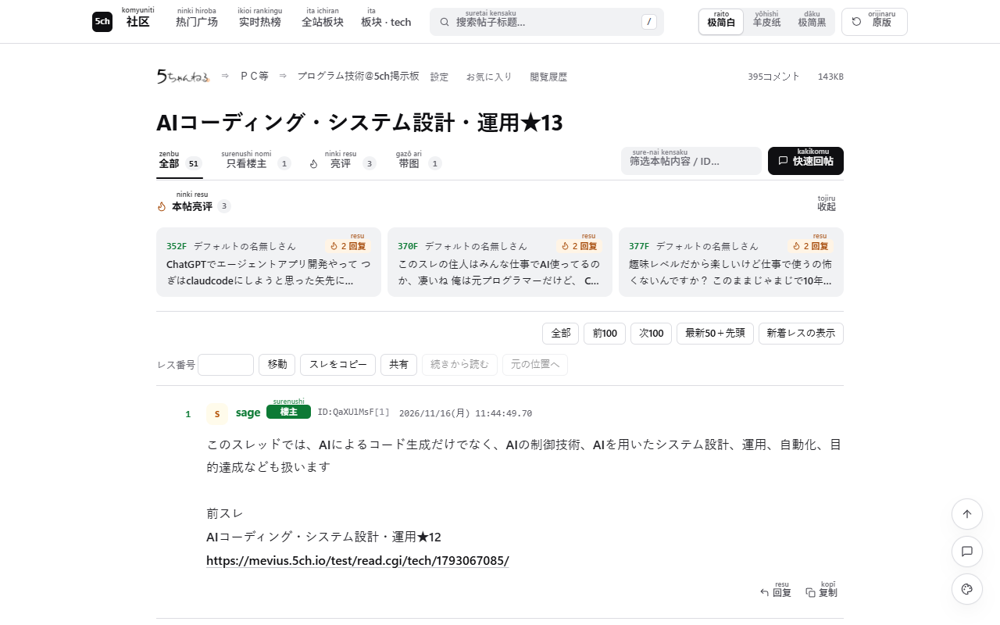
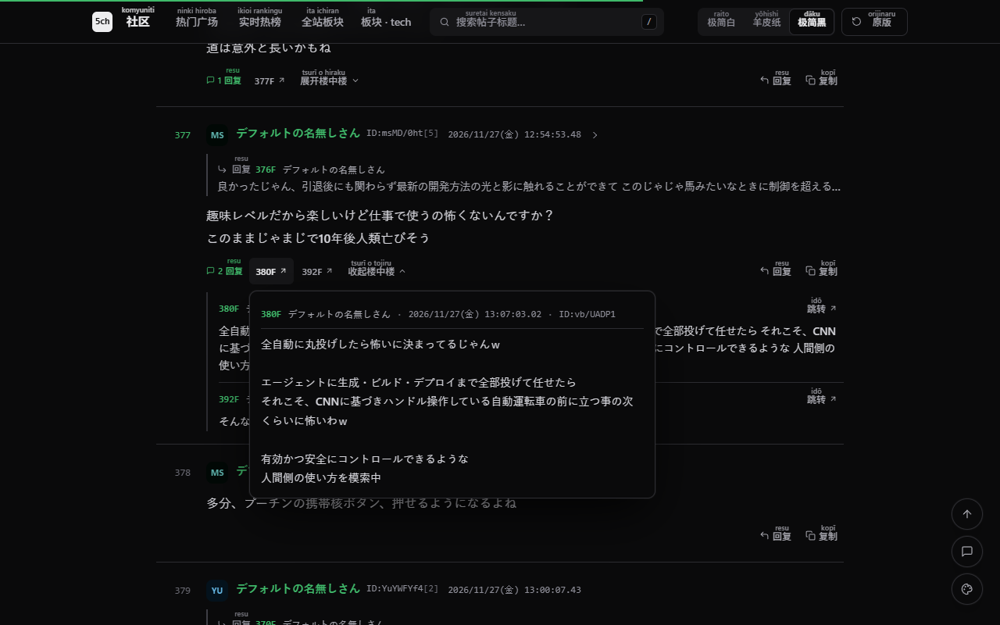

# 5ch 中文论坛风 UI 改造

**非官方扩展 · 非公式 · Unofficial** —— 与 5ch.io（5ちゃんねる）运营方无任何关系。

Chrome / Edge 扩展（Manifest V3）。把 [5ch.io](https://5ch.io/) 全站 10 类页面改成按中文论坛习惯组织、精致极简的阅读界面。插件自己的中文界面上方都注有日文意思的罗马字（如「回复」上注 `resu`、「楼主」上注 `surenushi`），中国人看汉字，日本人看罗马字。

[日本語](#日本語) · [English](#english)

| 极简白 · 帖子页 | 极简黑 · 楼中楼与悬停预览 |
| --- | --- |
|  |  |

## 功能

- **三套主题**：极简白 / 羊皮纸 / 极简黑，结构相同只换配色；楼层之间只用发丝线分隔，不套卡片。
- **帖子页**：楼层号放在左侧行号栏；回复别的楼层时，正文上方显示一行引用摘要，点击跳转、悬停预览；被回复的楼层可原位展开楼中楼；支持只看楼主、亮评、带图、只看某个 ID 和楼内搜词。
- **罗马音注音**：按钮、标签、提示、输入框占位和设置弹窗里的中文上方都有日文罗马字；5ch 自己的日文内容不加注。
- **全站 10 类页面**：首页、帖子、现代板块、旧版板块、subback、過去ログ、全站热榜、分类目录、全站板块导航、全站搜索。
- **广告净化**：隐藏侧栏、信息流和全屏插屏广告。
- **外链直达**：跳过 jump.5ch 中转页。
- **图片**：隐藏原版的打码小方块，直接显示缩略图，点击看大图。
- **其他**：任意页面按 `/` 聚焦全站搜索；顶栏「原版」按钮可临时切回 5ch 原样；遵守系统的「减少动态效果」设置。

广告净化、外链直达、图片、紧凑模式都可以在工具栏的设置弹窗里单独关闭。

## 安装

- **Chrome 应用商店**：审核中，通过后在这里补链接。
- **手动安装**：在 [Releases](https://github.com/Chrisutina/5ch-cn-forum-ui/releases) 下载 zip 并解压 → 打开 `chrome://extensions`（Edge 为 `edge://extensions`）→ 开启「开发者模式」→ 点「加载已解压的扩展程序」，选择解压出的文件夹 → 刷新 5ch 页面。

## 隐私

不收集、不上传任何数据，没有统计代码，也不加载远程代码；只在 5ch.io / 5ch.net 的页面上运行。详见 [PRIVACY.md](PRIVACY.md)。

## 开发

纯原生 JS + CSS，没有构建步骤。改完代码后在 `chrome://extensions` 点扩展卡片上的刷新按钮即可。

- `src/romaji.js`：中文 → 罗马字词典。改了界面中文后先跑 `node tools/check-romaji.mjs`，它会列出词典没覆盖到的中文（没覆盖的那段文字不会显示罗马音）。
- `tools/shoot.mjs`：把扩展加载进 Playwright 的 Chromium，打开真实的 5ch 页面截图，并检查横向溢出、对齐、悬停预览的对比度、罗马音是否被裁掉等项目，有失败时退出码为 1。需要 `playwright-core` 和它的 Chromium（`npm i --no-save playwright-core && npx playwright install chromium`）；装在别处时用环境变量 `PW_CORE`（playwright-core 目录）、`PW_CHROME`（chrome.exe 路径）指过去。截图输出到 `tools/shots/`。
- `tools/store-shots.mjs`：重新生成 `store/` 里的商店截图（1280×800）和小宣传图块（440×280）。上架填写的文案和隐私权回答在 [store/listing.md](store/listing.md)。

  ```
  node tools/shoot.mjs --themes shadcn,nga,dark
  node tools/shoot.mjs --widths 1024,390 --pages thread,home
  node tools/shoot.mjs --disabled --pages thread,board-legacy
  ```

- 打包上架用的 zip（只含运行时文件）：

  ```
  git archive --format=zip -o dist/5ch-cn-forum-ui-3.2.0.zip HEAD manifest.json _locales src styles popup icons
  ```

- 设计规范：[docs/2026-11-26-ui-redesign-design.md](docs/2026-11-26-ui-redesign-design.md)；更新记录：[CHANGELOG.md](CHANGELOG.md)。

## 许可

[MIT](LICENSE)

---

## 日本語

**非公式の拡張機能です。** 5ch.io（5ちゃんねる）の運営とは関係ありません。

[5ch.io](https://5ch.io/) の全 10 種類のページを、中国の掲示板風のすっきりしたレイアウトに組み替える Chrome / Edge 拡張機能（Manifest V3）です。拡張機能の UI は中国語ですが、中国語のラベルにはすべて日本語の意味をローマ字で上に添えています（例：「回复」の上に `resu`、「楼主」の上に `surenushi`）。5ch の本文やスレタイなど日本語の部分には何も付けません。

- **3 つのテーマ**：ライト / 羊皮紙 / ダーク。
- **スレ画面**：左側のレス番号欄、引用元へのジャンプとホバープレビュー、返信ツリーのその場展開、スレ主のみ・人気レス・画像付き・ID 絞り込み・スレ内検索。
- **全 10 種類のページ**：トップ、スレ、板（新 UI / 旧 UI）、subback、過去ログ、勢いランキング、カテゴリ一覧、全板一覧、検索。
- **広告除去・外部リンク直通・画像ギャラリー**：設定でそれぞれオフにできます。
- **プライバシー**：データの収集・送信は一切ありません（[PRIVACY.md](PRIVACY.md)）。

インストール：Chrome ウェブストア（審査中）、または [Releases](https://github.com/Chrisutina/5ch-cn-forum-ui/releases) の zip を展開し、`chrome://extensions` で「デベロッパー モード」をオンにして「パッケージ化されていない拡張機能を読み込む」から読み込んでください。

## English

**Unofficial** — not affiliated with 5ch.io.

A Chrome / Edge extension (Manifest V3) that restyles all 10 kinds of 5ch.io pages into a clean, Chinese-forum-style reading layout. The extension's own UI is in Chinese, and every Chinese label carries its Japanese meaning in romaji above it, so both Chinese and Japanese readers can use it.

Three themes (light / parchment / dark), a floor-number gutter, quote jumps with hover previews, inline reply trees, OP / popular / image / ID filters, ad cleanup and direct external links. No data is collected ([PRIVACY.md](PRIVACY.md)).

Install from the Chrome Web Store (in review), or download the zip from [Releases](https://github.com/Chrisutina/5ch-cn-forum-ui/releases), unzip it and load the folder via "Load unpacked" in `chrome://extensions` with Developer mode on. License: MIT.
